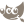

## Tiago Jarruge Saraiva - Software Developer and Designer 

Meu nome é Tiago Jarruge Saraiva, tenho 20 anos e sou natural do estado de São Paulo, Brasil. Ingressei na área de desenvolvimento de software há 3 anos juntamente com o ínicio de uma graduação em análise e desenvolvimento de sistemas no Instituto Federal de Ciência e Tecnologia de São Paulo, campus Campos do Jordão. Minhas áreas de experiência abrangem majoritariamente desenvolvimento de jogos e sites. Meus projetos concluídos e em andamento podem ser acessados no meu [portfolio](https://tiagojsaraiva.github.io/Portfolio/). Meu currículo completo pode ser acessado [aqui](https://github.com/TiagoJSaraiva/Portfolio/CV.pdf). Para entrar em contato comigo, envie uma mensagem no meu linkedin [www.linkedin.com/in/tiagojarrugesaraiva](www.linkedin.com/in/tiagojarrugesaraiva)

### Tecnologias e Ferramentas

**Principais**

  
  
  
  
  
  
  
  
  
  
  
  
  
  
  
  
  
  
  
  
  
  

**Outras**

  
  
  
  
  
  
  
  
  
  

### Estatísticas

  
  

